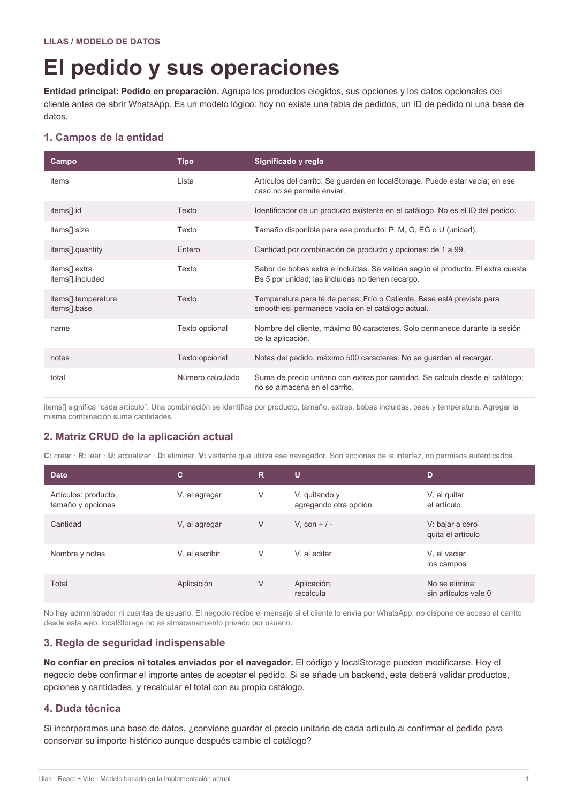

# Fuente autorizada: modelo de pedido

Lilas · React + Vite · Modelo basado en la implementación actual
1
LILAS / MODELO DE DATOS
El pedido y sus operaciones
Entidad principal: Pedido en preparación. Agrupa los productos elegidos, sus opciones y los datos opcionales del
cliente antes de abrir WhatsApp. Es un modelo lógico: hoy no existe una tabla de pedidos, un ID de pedido ni una base de
datos.
1. Campos de la entidad
Campo
Tipo
Significado y regla
items
Lista
Artículos del carrito. Se guardan en localStorage. Puede estar vacía; en ese
caso no se permite enviar.
items[].id
Texto
Identificador de un producto existente en el catálogo. No es el ID del pedido.
items[].size
Texto
Tamaño disponible para ese producto: P, M, G, EG o U (unidad).
items[].quantity
Entero
Cantidad por combinación de producto y opciones: de 1 a 99.
items[].extra
items[].included
Texto
Sabor de bobas extra e incluidas. Se validan según el producto. El extra cuesta
Bs 5 por unidad; las incluidas no tienen recargo.
items[].temperature
items[].base
Texto
Temperatura para té de perlas: Frío o Caliente. Base está prevista para
smoothies; permanece vacía en el catálogo actual.
name
Texto opcional
Nombre del cliente, máximo 80 caracteres. Solo permanece durante la sesión
de la aplicación.
notes
Texto opcional
Notas del pedido, máximo 500 caracteres. No se guardan al recargar.
total
Número calculado
Suma de precio unitario con extras por cantidad. Se calcula desde el catálogo;
no se almacena en el carrito.
items[] significa “cada artículo”. Una combinación se identifica por producto, tamaño, extras, bobas incluidas, base y temperatura. Agregar la
misma combinación suma cantidades.
2. Matriz CRUD de la aplicación actual
C: crear · R: leer · U: actualizar · D: eliminar. V: visitante que utiliza ese navegador. Son acciones de la interfaz, no permisos autenticados.
Dato
C
R
U
D
Artículos: producto,
tamaño y opciones
V, al agregar
V
V, quitando y
agregando otra opción
V, al quitar
el artículo
Cantidad
V, al agregar
V
V, con + / -
V: bajar a cero
quita el artículo
Nombre y notas
V, al escribir
V
V, al editar
V, al vaciar
los campos
Total
Aplicación
V
Aplicación:
recalcula
No se elimina:
sin artículos vale 0
No hay administrador ni cuentas de usuario. El negocio recibe el mensaje si el cliente lo envía por WhatsApp; no dispone de acceso al carrito
desde esta web. localStorage no es almacenamiento privado por usuario.
3. Regla de seguridad indispensable
No confiar en precios ni totales enviados por el navegador. El código y localStorage pueden modificarse. Hoy el
negocio debe confirmar el importe antes de aceptar el pedido. Si se añade un backend, este deberá validar productos,
opciones y cantidades, y recalcular el total con su propio catálogo.
4. Duda técnica
Si incorporamos una base de datos, ¿conviene guardar el precio unitario de cada artículo al confirmar el pedido para
conservar su importe histórico aunque después cambie el catálogo?
